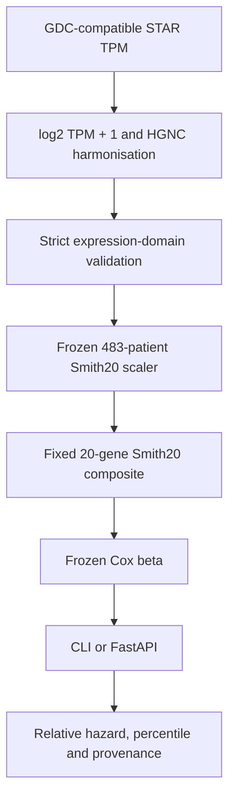

# hypoxia-pipeline

`hypoxiapipe` is a reproducible prostate-cancer transcriptomics and survival-ML
pipeline built around the fixed Smith20 signature. It provides research-use CLI,
FastAPI, and Docker inference from a frozen biochemical-recurrence Cox model,
with provenance and checksum verification. **It is not a clinical device. The
frozen STAR-native predictor has no independent STAR-compatible external
validation.**

## What it does

1. Ingests prostate tumour transcriptomic cohorts with recorded source checksums.
2. Scores the fixed Smith20 biological signature.
3. Constructs the separate longitudinal TCGA-PRAD biochemical-recurrence endpoint.
4. Evaluates survival models with training-only preprocessing and nested validation.
5. Loads a frozen STAR-Smith20-Cox v1 research model for individual inference.
6. Serves that model through the CLI and FastAPI with manifest verification.

`/score/*` is research signature scoring; `/predict/recurrence` is inference from
the frozen trained model. Their inputs and interpretations differ.



## Quickstart

```bash
pip install -e ".[api]"
hypoxiapipe model inspect --model models/prad-bcr-star-smith20-cox-v1
hypoxiapipe model predict \
  --model models/prad-bcr-star-smith20-cox-v1 \
  --expression docs/examples/recurrence-expression.tsv \
  --expression-type gdc_star_tpm_log2p1_hgnc

HYPOXIAPIPE_MODELS=models \
  uvicorn hypoxiapipe.api.app:app --host 0.0.0.0 --port 8000
```

In another shell, request `GET /health`, `GET /models`, then submit the
[synthetic JSON example](docs/examples/recurrence-prediction.json) to
`POST /predict/recurrence`:

```bash
curl http://localhost:8000/health
curl http://localhost:8000/models
curl -X POST http://localhost:8000/predict/recurrence \
  -H 'Content-Type: application/json' \
  --data @docs/examples/recurrence-prediction.json
```

Container quickstart (when Docker is available):

```bash
docker build -f docker/Dockerfile.api -t hypoxiapipe-api:0.1.0 .
docker run --rm -p 8000:8000 hypoxiapipe-api:0.1.0
```

The two example inputs are **synthetic schema demonstrations**. Twenty arbitrary
numbers are not a valid biological assay: real inputs must already meet the
`gdc_star_tpm_log2p1_hgnc` contract. See the
[model card](docs/models/prad-bcr-star-smith20-cox-v1.md) for evidence and limits.

## Model evidence and limits

| Evidence | Population or evaluation | Result |
| --- | --- | --- |
| Development | TCGA-PRAD GDC STAR | 483 patients; 97 BCR events after 60-month censoring |
| Internal held-out evaluation | Repeated nested CV, fixed Smith20 Cox (M0) | Mean Harrell C = 0.682540 |
| External Smith20 association | MSKCC | HR = 1.937 |
| External Smith20 association | Cambridge | HR = 1.798 |
| External Smith20 association | Stockholm | HR = 1.734 |

These external cohorts validate the cohort-relative Smith20 prognostic
association, not the frozen STAR-native predictor. The model card separates
the internal predictive estimate from the fitted development-cohort statistics
and documents proportional-hazards and input-domain limitations. No absolute
recurrence probabilities, clinical risk categories, or treatment advice are provided.

## Tests and CI

Run `ruff check src tests`, `ruff format --check src tests`, `mypy --strict src`,
and `pytest -q`. GitHub Actions also verifies the frozen bundle, builds the API
image, and runs the known-prediction smoke test. See the
[v0.1.0 release notes](docs/releases/v0.1.0.md) for the release scope and limits.

## Why

A benchmark in the upstream research project was invalidated by a comparator gene list
that shared only **4 of 32 genes** with the published signature it was labelled as. The
error survived for months across three scripts because nothing verified gene-list
provenance — a comment citing the source paper sat directly above the wrong genes.

This package makes that class of error structurally impossible: signatures are
content-addressed YAML specs, and loading one verifies its SHA-256. An edited gene list
fails loudly instead of silently producing plausible numbers.

## Install

```bash
pip install -e ".[dev]"
```

## Use

```bash
hypoxiapipe sig list                      # bundled signatures + verification status
hypoxiapipe sig verify path/to/spec.yaml  # non-zero exit on checksum failure
hypoxiapipe sig hash spec.yaml --write    # re-hash after verifying against source
hypoxiapipe score matrix.tsv -s ragnum32  # score samples (genes x samples input)

hypoxiapipe cohort list                   # bundled cohort specs + pinned expectations
hypoxiapipe cohort inspect cambridge      # list the clinical columns GEO actually returns
hypoxiapipe cohort build cambridge -o out/cambridge -s smith20
hypoxiapipe cohort build tcga-prad -o out/prad -s smith20   # GDC manifest + STAR counts
hypoxiapipe cohort qc out/cambridge -s smith20   # re-QC a stored cohort, checksum verified

hypoxiapipe manifest show out/cambridge   # what went in, what came out, on which code
hypoxiapipe manifest verify out/cambridge # re-hash the outputs; non-zero exit on drift

hypoxiapipe model validate out/cambridge -s smith20      # per-SD Cox HRs, fitted in R
hypoxiapipe model validate out/cambridge -s smith20 --action quartile
hypoxiapipe model cv out/cambridge --estimator coxnet -o out/cv   # nested CV
```

### Frozen STAR Smith20 Cox research inference

The `prad-bcr-star-smith20-cox-v1` bundle accepts **prostate tumour expression on the
GDC-compatible STAR TPM scale after log2(TPM + 1) and hypoxiapipe HGNC-symbol
harmonisation**. The required expression type is `gdc_star_tpm_log2p1_hgnc`; the CLI
does not infer it from numbers. DESeq2 VST, RSEM, microarray, FPKM, raw counts and
arbitrary normalized matrices are outside this input contract.

Supply a TSV with gene symbols in its first column, genes as rows, and one or more
samples as columns. All 20 Smith20 genes are required; extra genes are ignored. For
example, a file starts with `gene<TAB>sample_1` followed by gene/value rows:

```bash
hypoxiapipe model inspect --model models/prad-bcr-star-smith20-cox-v1
hypoxiapipe model predict \
  --model models/prad-bcr-star-smith20-cox-v1 \
  --expression example.tsv \
  --expression-type gdc_star_tpm_log2p1_hgnc
hypoxiapipe model predict \
  --model models/prad-bcr-star-smith20-cox-v1 \
  --expression example.tsv \
  --expression-type gdc_star_tpm_log2p1_hgnc \
  --format tsv --output predictions.tsv --metadata-output predictions-metadata.json
```

`--format json` emits a predictions array and one shared provenance/interpretation
object. `--format tsv` emits the seven prediction columns; the optional metadata file
holds provenance separately. The default is a readable table. A research-use warning
goes to stderr so it does not corrupt machine-readable stdout.

The Smith20 score uses frozen TCGA training means and SDs. The linear predictor is
Cox beta times that standardized score; relative hazard is its exponential relative
to model score zero. Percentile is the score's position in the frozen TCGA training
distribution. **None is an absolute recurrence probability.** This research-use
predictor has no independent STAR-compatible external validation.

`cohort build` runs the whole ingest path: fetch (cached), map probes to symbols via the
platform annotation, harmonise symbols onto the pinned HGNC release, infer or apply the
log2 transform, derive the survival endpoint, restrict to the analysis set, QC, and save.
It exits non-zero if QC fails or the cohort contradicts the expectations pinned in its spec.

## Cohort specs

A cohort spec pins an accession, its platform, how the endpoint is encoded, and what the
built cohort should contain:

```yaml
name: Cambridge
source: geo
accession: GSE70768
platform: GPL10558
endpoint:
  time_column: bcr_free_time
  event_column: bcr_status
  time_unit: months        # required - days and months look identical until the HRs move
  cap_months: 60           # administrative censoring, recorded as a provenance step
expect:
  n_samples: 111           # asserted at build time, not documentation
```

Two ordering rules are enforced rather than left to the caller. Symbol harmonisation runs
before scoring, because a signature listing `CYR61` scores nothing against a matrix
labelled `CCN1` and the coverage report calls the gene missing. Restriction to the
analysis set runs before any standardisation, because per-gene z-scores are relative to
the samples in the matrix — standardising the full matrix and then subsetting gives
different scores from subsetting first. Every built cohort carries the
`population_hash` its scores are relative to.

## Scoring methods

| method | definition | use |
|---|---|---|
| `rowmean` | per-gene z across samples, then mean | default; equal gene weighting |
| `median_z` | median raw expression, then z | legacy; dominated by high-expression genes |
| `weighted` | Σ(coefficient × per-gene z) | signatures published with Cox coefficients |

Yang28 **must** be scored `weighted`: it is directionally mixed, so unweighted averaging
cancels (verified: unweighted null; weighted HR 1.63, P=4e-4 in TCGA-PRAD).

## TCGA

A TCGA cohort is assembled from several hundred per-aliquot STAR-counts files, each a
UUID that means nothing on its own. `cohort build tcga-prad` queries the GDC files
endpoint, caches the manifest, fetches and hashes every file individually, then makes
three joins that each silently produce a wrong cohort if done carelessly:

- **aliquot → patient** — expression is per aliquot (`TCGA-CH-5761-01A-11R-1580-07`),
  clinical is per patient (`TCGA-CH-5761`); joining without truncating gives an empty
  intersection, truncating without deduplicating gives duplicate patients;
- **tumour vs normal** — adjacent normals sit in the same project and widen every gene's
  apparent dynamic range;
- **Ensembl versions** — `ENSG00000141510.16` changes suffix between GDC releases.

Losses at each stage are counted in the build report rather than inferred from a total,
and `tolerate_file_failures` is 0 by default: a cohort quietly missing samples is a
different cohort from the one the manifest describes.

### The PRAD endpoint problem

GDC clinical carries no usable recurrence outcome for prostate, and overall survival in
TCGA-PRAD has roughly a dozen events across ~500 patients — a model fitted on that returns
a hazard ratio, a confidence interval and a p-value that all look like results. The
pipeline therefore takes the endpoint from the **TCGA Clinical Data Resource** (Liu et al.,
*Cell* 2018) and uses **PFI**, the endpoint those authors recommend for PRAD.

Asking for OS or DSS in PRAD raises. Overriding requires `allow_discouraged=True` in code,
not a different string in a config file. The CDR table is a supplementary file from that
paper and is **not redistributed here** — point `clinical_path` at your own copy.

## Containers

Two images, not one:

| image | contents | entry point |
|---|---|---|
| `hypoxiapipe` | ingest, QC, harmonise, score, model, provenance | `hypoxiapipe` CLI |
| `hypoxiapipe-r` | R + `survival` + `jsonlite` and the worker | the worker itself |

```bash
make images
export HYPOXIAPIPE_R_COMMAND="docker run --rm -i ghcr.io/OWNER/hypoxiapipe-r:TAG"
hypoxiapipe model validate out/prad -s smith20      # survival runs in the R image
```

`HYPOXIAPIPE_R_COMMAND` replaces the command used to reach the worker. Because the
contract is one JSON request on stdin and one response on stdout, any transport that
honours it works — a local `Rscript`, a container, a remote shell — with no service, no
socket and no shared volume. That indirection is what the narrow contract bought.

A single fat container would be larger, slower to rebuild, and would make the
per-process containers in Phase 7 meaningless, since every process would run the same
image. The Python image installs no R; the R image installs no Python package, and both
run as non-root.

## Workflow

```bash
python tools/make_test_fixtures.py
nextflow run workflow/main.nf -profile test              # offline, ~20s

nextflow run workflow/main.nf -profile docker \
    --cohorts cambridge,stockholm,tcga-prad \
    --signatures smith20,ragnum32 \
    --actions cox_persd,quartile \
    --estimators coxnet
```

Cohorts fan out as a channel: each is built, validated and cross-validated independently
and in parallel, then collected. That is the only reason to use a workflow manager here
rather than a driver script — four cohorts on a laptop and four cohorts on AWS Batch are
the same DSL with a different `-profile`.

Containers are declared **per process**, not globally, which is what the split images from
Phase 6 were for. The `docker` and `singularity` profiles set `HYPOXIAPIPE_R_COMMAND` so
the survival call reaches the R image identically in every environment.

Failures terminate rather than retry: `-resume` makes re-running a long ingest cheap, so
silently retrying a failure is worse than stopping and showing it. Every run writes a
timeline, report, trace and DAG into `results/pipeline_info/`, alongside the per-step
manifests the package itself writes.

## Result

smith20 was derived in TCGA-PRAD, so that cohort is in-sample. Cambridge and
Stockholm are independent — a different platform, a different endpoint definition:

| cohort | n | events | HR per SD | 95% CI | P | C-index |
|---|---|---|---|---|---|---|
| TCGA-PRAD (discovery) | 497 | 87 | 1.93 | 1.54–2.42 | 1.5e-8 | 0.662 |
| Cambridge | 111 | 19 | 1.87 | 1.16–2.99 | 0.0097 | 0.651 |
| Stockholm | 92 | 40 | 1.75 | 1.28–2.38 | 0.00042 | 0.605 |

Cambridge has 19 events, so its interval is wide and QC warns that a quartile
analysis there is underpowered; per-SD leads. All three are reproducible from
their accessions by the commands above, and frozen in `tests/golden/`.

## Golden references

`tests/golden/tcga-prad.json` freezes the results of a verified real build — counts at
every assembly stage, the `population_hash`, signature coverage, and the fitted survival
estimates. `tests/test_golden.py` compares a freshly built cohort against it:

```bash
hypoxiapipe cohort build prad.yaml --out out/prad -s smith20
HYPOXIAPIPE_GOLDEN_COHORT=out/prad pytest tests/test_golden.py -v
```

They skip when no built cohort is available, which is the honest default — a regression
test that silently passes when it cannot run is worse than one that says it did not run.

No cohort data is stored: only counts, hashes and statistics, so the reference is
checkable without redistributing bulky or controlled files. `expr_checksum` is
deliberately *not* asserted — it moves whenever GDC re-releases the underlying files,
which is a data change rather than a regression, and a test that fails on a legitimate
upstream release trains people to ignore it. `population_hash` is asserted, because it
covers the exact sample set every score is relative to.

## Scoring service

```bash
pip install -e ".[api]"
hypoxiapipe reference create out/prad -s smith20      # freeze a named population
HYPOXIAPIPE_REFERENCES=references uvicorn hypoxiapipe.api.app:app
```

Two scoring endpoints, and the difference between them is the point:

| endpoint | scores relative to | one sample? |
|---|---|---|
| `POST /score/batch` | the submitted cohort | **422** |
| `POST /score/reference` | a registered reference cohort | yes |

Every scoring method here is cohort-relative — `rowmean` and `weighted` z-score
each gene across the samples supplied, `median_z` standardises across them — so a
score is a property of a patient *and the batch they arrived in*. With one sample
there is no distribution, and returning a well-formed number for it would be the
most dangerous thing in this repository: a result that looks right, gets stored and
plotted, and is meaningless.

So `/score/batch` refuses, explains why, and points at `/score/reference`, which
scores against frozen statistics from a named cohort. Responses carry the reference
id, its scaler checksum, and the population hash of the cohort it came from — see
[ADR 0013](docs/adr/0013-single-sample-scoring-is-refused.md).

## Frozen recurrence-model API

Configure a directory of approved model bundles explicitly. At startup, every
immediate child bundle is checked against its manifest; a corrupt configured
bundle stops startup with a path-free integrity error. With no
`HYPOXIAPIPE_MODELS` setting, or an empty directory, signature scoring remains
available and `/models` is empty. `/health` reports liveness and model count;
`/ready` reports readiness without running inference. Clients select a
registered `model_id` and cannot submit a filesystem path or artifact URL.

```bash
HYPOXIAPIPE_MODELS=models \
  uvicorn hypoxiapipe.api.app:app --reload

curl http://localhost:8000/health
curl http://localhost:8000/ready
curl http://localhost:8000/models
curl http://localhost:8000/models/prad-bcr-star-smith20-cox-v1
curl -X POST http://localhost:8000/predict/recurrence \
  -H 'Content-Type: application/json' \
  --data @docs/examples/recurrence-prediction.json
```

The example JSON is a synthetic one-patient request with all 20 required genes.
Show the relative hazard, training percentile and checksums, then submit that
same patient alongside others: their individual prediction fields are identical.
`/docs` provides the full request and response schemas and a valid example.
For a short live walkthrough after starting the API, run
`python3 scripts/demo_model_api.py`; add `--known-fixture` for the committed
TCGA numerical regression used in CI.

`/score/*` performs signature scoring for research analysis. In particular,
`/score/batch` is cohort-relative and refuses one sample. In contrast,
`/predict/recurrence` applies the frozen **trained** STAR-Smith20-Cox v1 model
to one or many patients using its stored TCGA training statistics. It requires
`expression_type=gdc_star_tpm_log2p1_hgnc`, genes as rows, samples as columns,
and all 20 Smith20 genes. The response is research-use only: relative hazard
and percentile are not absolute recurrence probabilities. The frozen predictor
has not yet received independent STAR-compatible external validation.

## Run manifests

Every `cohort build` writes a `manifest.json` recording the run: the accession and the
checksum of the bytes fetched, each signature and its registry hash, the symbol authority
and the hash of the mapping table, the package version, git SHA (with `-dirty`), container
digest where set, the parameters, and the hash of every file written.

`manifest verify` re-hashes those outputs and exits non-zero if any is missing or has
changed, so a stale result on disk is detectable rather than assumed current. The
manifest's own `manifest_hash` covers inputs and parameters but not outputs, which
accumulate as a run proceeds — it identifies *this run, so configured*.

The point is narrow and worth stating plainly: the failure this project came out of was
not a bug in anyone's code, it was an input that quietly stopped being what its label
said. A result with a manifest can be re-checked against its inputs a year later.

## Modelling

Survival estimation runs in **R** (`survival`) behind a JSON stdin/stdout contract; the
Python side handles data, folds and provenance. Reimplementing `survival` in Python would
cost weeks and be worse than the original, and a silent Python fallback would mean two
different estimators producing results with the same label — so R's absence is a clear
error, never a substitution.

Model selection uses nested cross-validation, and **preprocessing is fitted inside every
fold**. Standardising before splitting lets held-out samples shape the training features;
it never errors, and the optimism is small enough to look like a real result.
`ReferenceScaler` separates `fit` from `transform` so the constants that trained a model
are the ones any later cohort is scored against — which is also what makes a single-sample
prediction well defined, and why the planned service exposes `/score/reference`.

`assert_no_leakage` tests that property directly: perturb only the held-out samples and
the training scaler's checksum must not move.

## Decisions

The choices that shaped this pipeline are recorded in [docs/adr](docs/adr/), written as
they were made rather than reconstructed afterwards. Each states what was actually in
tension, what it costs, and what evidence would reverse it. The load-bearing ones:

- [0006](docs/adr/0006-survival-runs-in-r.md) — survival runs in R with **no** Python
  fallback, because two estimators under one label is the failure this project came from
- [0008](docs/adr/0008-prad-endpoint-is-cdr-pfi.md) — TCGA-PRAD refuses overall survival:
  ~12 events in 500 patients produces numbers shaped like results
- [0007](docs/adr/0007-preprocessing-frozen-inside-folds.md) — preprocessing frozen inside
  every fold, with the leakage property tested rather than asserted
- [0011](docs/adr/0011-duckdb-deferred.md) — DuckDB deliberately *not* built yet

## Status

Phases 1–4, 6 and 7 of 10 complete: package core (registry, scoring, CLI); ingest/QC/harmonise
(GEO and TCGA/GDC ingest, probe mapping, pinned HGNC symbols, endpoint derivation,
cohort store);
provenance (content hashing, run manifests, verification); modelling (frozen preprocessing,
coxnet, random survival forest, nested CV, R survival bridge); containers and CI
(split Python/R images, GHCR publishing, pluggable R transport); Nextflow DSL2
orchestration with an offline test profile that runs the full DAG in ~20s; a
FastAPI scoring service that refuses scientifically invalid single-sample requests.
287 tests, all offline, plus golden-file regression tests against verified
builds of all three cohorts (TCGA-PRAD on GDC release 46.0, Cambridge and
Stockholm from GEO). Decisions recorded in [docs/adr](docs/adr/).
MLflow/API and cloud execution follow.

DuckDB is deliberately not built yet: a metadata store that nothing queries is decoration,
so it lands with the reporting layer that reads from it.
